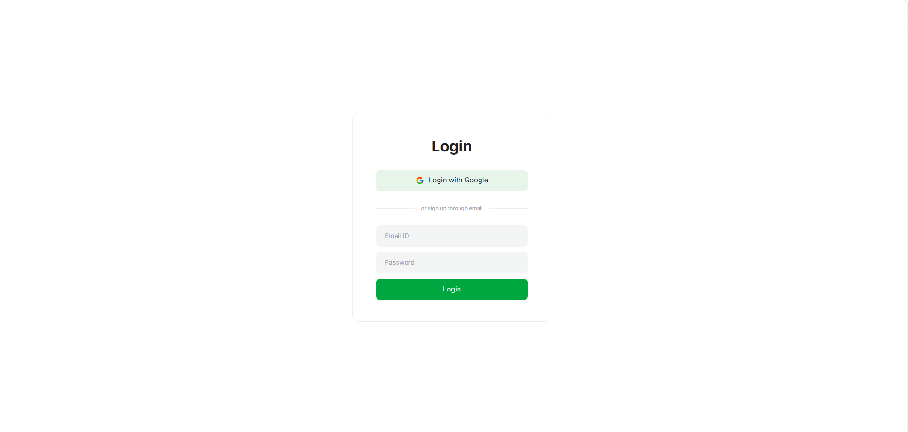
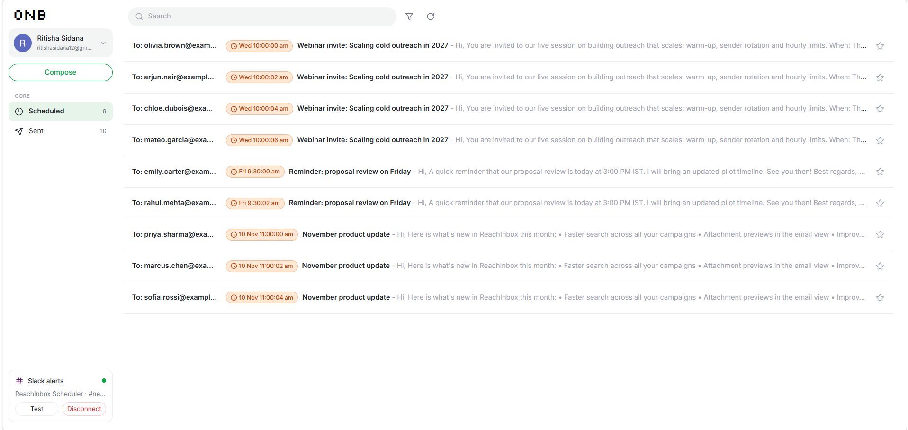
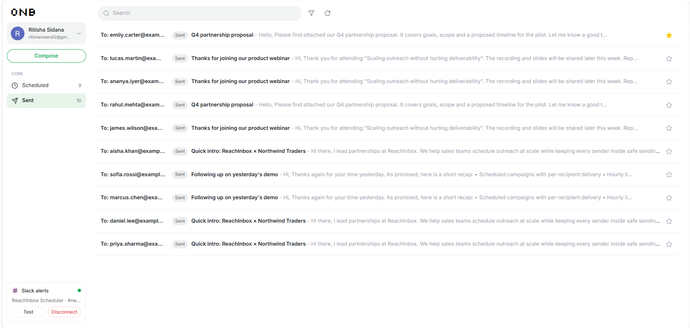
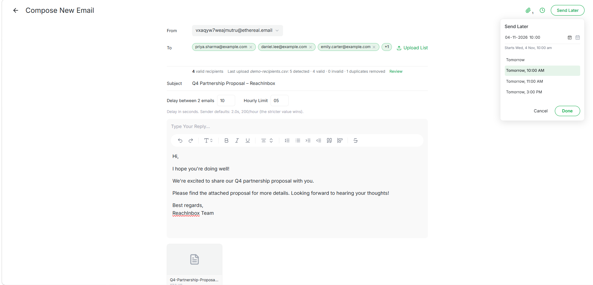
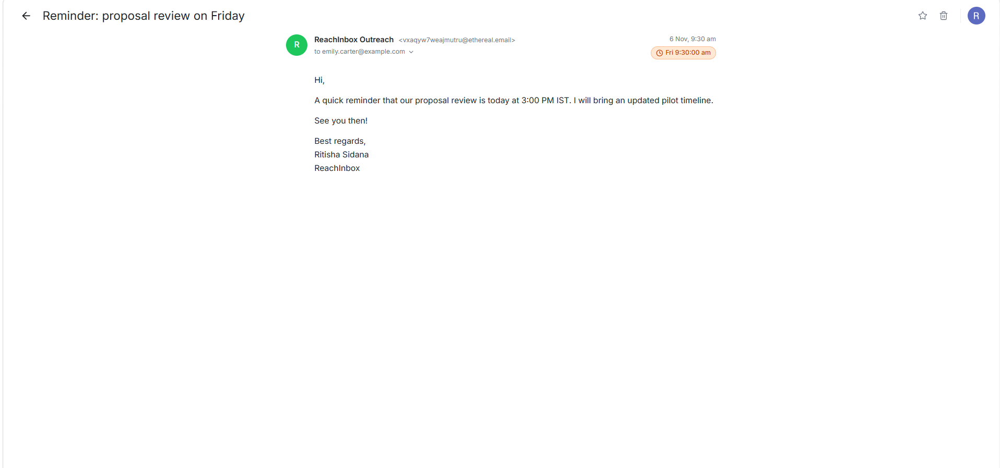

# ReachInbox — Email Job Scheduler

A full-stack email scheduling platform: authenticated users compose a message, upload a recipient list, pick a start time, and the system delivers one email per recipient through Ethereal SMTP — with per-sender rate limiting, minimum spacing between sends, retries, restart safety, Elasticsearch search, Slack alerts and a Bull Board queue dashboard.

> Built for the ReachInbox (Outbox Labs) Software Development Intern assignment.

---
## Contents

1. [Key Features](#key-features)
2. [Tech Stack](#tech-stack)
3. [Architecture](#architecture)
4. [Folder Structure](#folder-structure)
5. [Quick Start](#quick-start)
6. [Environment Configuration](#environment-configuration)
7. [External Setup: Ethereal, Google, Slack, Elasticsearch](#external-setup)
8. [API Reference](#api-reference)
9. [How the Queue Works](#queue-architecture)
10. [Rate Limiting & Spacing](#rate-limiting-and-spacing)
11. [Persistence, Idempotency & Delivery Semantics](#persistence-idempotency-and-delivery-semantics)
12. [Concurrency](#concurrency)
13. [Behaviour with 1000+ Emails at the Same Time](#1000-emails-scheduled-for-the-same-time)
14. [Testing](#testing)
15. [Assumptions & Trade-offs](#assumptions-and-trade-offs)
16. [Feature Checklist](#feature-checklist)

---

## Key Features

* **Google OAuth Authentication:** Secure user authentication through Google OAuth 2.0.
* **Email Scheduling:** Schedule emails for future delivery with customizable date and time.
* **Bulk Recipient Upload:** Upload CSV files containing multiple recipients with email validation and duplicate detection.
* **Rich Email Composition:** Compose emails with a rich-text editor, subject, body and file attachments.
* **Configurable Rate Limiting:** Set hourly sending limits and delays between consecutive emails.
* **Scheduled & Sent Mailboxes:** View scheduled and successfully sent emails with individual email details.
* **Search & Filtering:** Search emails and filter them based on their status.
* **Email Attachments:** Attach files to emails and access them through email details.
* **Slack Notifications:** Receive Slack alerts when sender hourly limits are reached.
* **Background Job Processing:** Process scheduled emails using BullMQ and Redis.
* **Automatic Retry Handling:** Retry transient email delivery failures with backoff.
* **Concurrency Control:** Process multiple email jobs concurrently while respecting sender limits.
* **Queue Monitoring:** Monitor background jobs, including completed, delayed and failed jobs, through Bull Board.
* **Persistent Scheduling:** Store email and campaign data in PostgreSQL to support recovery after application restarts.
* **Email Search Indexing:** Use Elasticsearch to support fast email search.


## Tech stack

| Layer | Technology |
|---|---|
| Backend | Node.js, TypeScript, Express, Prisma ORM, Zod |
| Queue | BullMQ on Redis (AOF persistence), Bull Board |
| Data | PostgreSQL (source of truth), Elasticsearch 8 (search index) |
| Email | Nodemailer → Ethereal SMTP |
| Auth | Google OAuth 2.0 (authorization code flow, server-verified ID token), Redis-backed HTTP-only sessions |
| Notifications | Slack OAuth v2 + `chat.postMessage` (incoming-webhook fallback) |
| Frontend | React 18, Vite, TypeScript, Tailwind CSS, React Router, Axios, Lucide icons |
| Infra | Docker Compose (Postgres, Redis, Elasticsearch) |

## Application Screenshots

### Login


### Scheduled Emails


### Sent Emails


### Compose Email


### Email Details


## Architecture

```
 Browser (React SPA, :5173) ──/api, /admin (Vite proxy, session cookie)──►  Express API (:4000)
                                                                              │
     ┌──────────────────────────────────────┬───────────────────────────────┼──────────────────────────┐
     ▼                                      ▼                               ▼                          ▼
 PostgreSQL (Prisma)                 Redis (AOF)                    Elasticsearch               Slack / Google
 users, senders, campaigns,     BullMQ queues, sessions,          "emails" index              OAuth + Web API
 emails, attachments,           rate-limit counters (Lua)          (derived data)
 search outbox, alerts                 │
                                       ▼
                      Workers (in-process or `npm run start:worker`, N instances)
                      ├─ email-send     → hourly slot + spacing slot (Lua) → claim row → SMTP → mark SENT
                      ├─ notifications  → "hourly limit reached" Slack alert (de-duplicated)
                      └─ search-sync    → drains the transactional outbox into Elasticsearch
```

**Key principles**
- **PostgreSQL is the source of truth.** Redis holds execution state (jobs, counters); Elasticsearch holds a rebuildable index.
- **One recipient = one `Email` row = one BullMQ delayed job** with a stable job ID `email-<emailId>`.
- **No cron.** Sending is driven only by per-email delayed jobs. (The only repeating job is an Elasticsearch outbox sweep — index maintenance, not email scheduling.)
- **All cross-instance coordination happens in Redis** with atomic Lua scripts, so any number of API/worker processes can run.

## Folder Structure

```
reachinbox-email-scheduler/
├── docker-compose.yml              # Postgres 16, Redis 7 (AOF, noeviction), Elasticsearch 8
├── docs/
│   └── REQUIREMENTS_CHECKLIST.md
├── images/
│   ├── login.png
│   ├── scheduled.png
│   ├── sent.png
│   ├── compose.png
│   └── email-details.png
├── backend/
│   ├── prisma/                     # schema.prisma + migrations
│   ├── scripts/                    # create-sender.ts, load-test.ts
│   ├── tests/
│   │   ├── unit/
│   │   └── integration/            # Vitest tests, including real-Redis Lua tests
│   └── src/
│       ├── config/                 # Environment validation (Zod)
│       ├── db/                     # Prisma, Redis, Elasticsearch clients
│       ├── queues/                 # Queue definitions, job types, stable job IDs
│       ├── workers/                # Email, notification, search workers
│       ├── services/               # Email, sender, rate limiter, mailer, search, Slack, auth, notifications
│       ├── controllers/            # HTTP handlers
│       ├── routes/                 # API route definitions
│       ├── middleware/             # Auth, sessions, validation, uploads, error handling
│       ├── validators/             # Zod request schemas
│       ├── admin/                  # Bull Board
│       ├── utils/                  # Crypto, recipients, HTML, time, errors
│       ├── app.ts                  # Express application
│       ├── server.ts               # API server entry point
│       └── worker.ts               # Standalone worker entry point
└── frontend/
    └── src/
        ├── components/             # UI kit, EmailRow, Sidebar, SlackCard, compose components
        ├── pages/                  # Login, EmailList, EmailDetail, Compose
        ├── layouts/                # DashboardLayout
        ├── services/               # Axios API layer
        ├── hooks/                  # useEmailList, useCounts, useDebounce, useClickOutside
        ├── context/                # AuthContext, ToastContext
        ├── types/                  # Shared TypeScript types
        └── utils/                  # Formatting, recipient validation
```


## Quick start

Prerequisites: Node.js ≥ 20, Docker Desktop.

```bash
# 1. Infrastructure
docker compose up -d --wait

# 2. Backend
cd backend
cp .env.example .env
npm install
npm run keys:generate          # paste SESSION_SECRET and ENCRYPTION_KEY into .env
#   + fill GOOGLE_* (and optionally SLACK_*) — see "External setup"
npx prisma migrate deploy
npm run dev                    # API on :4000, workers run in-process (RUN_WORKERS_IN_API=true)

# 3. Frontend (new terminal)
cd frontend
npm install
npm run dev                    # http://localhost:5173
```

Open http://localhost:5173 → **Login with Google**. On first login an Ethereal sender is created automatically (`AUTO_PROVISION_ETHEREAL_SENDER=true`); more can be added from the Compose "From" dropdown.

Bull Board: http://localhost:5173/admin/queues (or :4000/admin/queues) — requires login; restrict with `ADMIN_EMAILS`.

**Scaling workers horizontally:** set `RUN_WORKERS_IN_API=false`, then run `npm run dev` (API) plus any number of `npm run dev:worker` (or `npm run build && npm run start:worker`) processes.

## Environment configuration

All variables are documented in [`backend/.env.example`](backend/.env.example) and validated at startup (the process exits with a clear message if something is wrong). Highlights:

| Variable | Default | Purpose |
|---|---|---|
| `DATABASE_URL`, `REDIS_URL`, `ELASTICSEARCH_URL` | docker-compose values | Infrastructure |
| `SESSION_SECRET` | – (required, ≥ 32 chars) | Signs session cookie and Slack OAuth state |
| `ENCRYPTION_KEY` | – (required, 64 hex) | AES-256-GCM key for SMTP passwords & Slack tokens at rest |
| `GOOGLE_CLIENT_ID/SECRET/REDIRECT_URI` | – | Google OAuth |
| `SLACK_CLIENT_ID/SECRET/REDIRECT_URI`, `SLACK_SCOPES` | – | Slack OAuth |
| `WORKER_CONCURRENCY` | 5 | Jobs processed in parallel per worker process |
| `MIN_EMAIL_DELAY_MS` | 2000 | Global floor for spacing between two sends of one sender |
| `MAX_EMAILS_PER_HOUR_PER_SENDER` | 200 | Global ceiling of a sender's hourly volume |
| `EMAIL_JOB_ATTEMPTS`, `EMAIL_JOB_BACKOFF_MS` | 5, 10000 | Retry policy (exponential backoff) |
| `RATE_LIMIT_LOOKAHEAD_HOURS` | 168 | How far ahead the limiter searches for a free hour |
| `RUN_WORKERS_IN_API` | true | Run workers inside the API process |
| `FRONTEND_URL`, `BACKEND_URL` | localhost:5173 / :4000 | Redirects and CORS |

Frontend: [`frontend/.env.example`](frontend/.env.example) (`VITE_BACKEND_URL` for the dev proxy).

**Effective limits per email** = the strictest of: global env value, the sender's own setting, and the optional per-campaign value from the Compose screen ("Delay between 2 emails" in seconds, "Hourly Limit").

## External setup

### Ethereal (SMTP)
No manual setup required. Senders are real Ethereal accounts created through Ethereal's API (`POST https://api.nodemailer.com/user`) — automatically on first login, or via **Compose → From → Add Ethereal sender**, `POST /api/senders`, or `npm run sender:create -- <your-google-email> "Name" [hourlyLimit] [minDelayMs]`. To reuse an existing Ethereal account, pass `smtpUser`/`smtpPass` to `POST /api/senders` (credentials are verified, then encrypted). Every sent email stores an Ethereal **preview URL**, linked from the email detail page.

### Google OAuth
1. Google Cloud Console → *APIs & Services* → *OAuth consent screen*: External, add your account as a test user.
2. *Credentials* → *Create credentials* → *OAuth client ID* → **Web application**.
3. Authorized redirect URI: `http://localhost:4000/api/auth/google/callback`.
4. Put the client ID/secret in `backend/.env` (`GOOGLE_REDIRECT_URI` must match exactly) and restart the backend.

Flow: `/api/auth/google` (CSRF `state` stored in session) → Google → callback exchanges the code, **verifies the ID token signature/audience/expiry server-side**, upserts the user, regenerates the session (anti-fixation), redirects to the dashboard. The browser only holds an HTTP-only, SameSite=Lax cookie; session data lives in Redis.

### Slack OAuth
1. https://api.slack.com/apps → *Create New App* → From scratch.
2. *OAuth & Permissions* → Bot token scopes: `chat:write`, `chat:write.public`, `incoming-webhook`.
3. Redirect URL: Slack requires HTTPS, so expose the backend with a tunnel, e.g. `ngrok http 4000`, and add `https://<id>.ngrok-free.app/api/slack/callback`.
4. *Basic Information* → copy Client ID / Secret into `.env` (`SLACK_REDIRECT_URI` = the tunnel URL above). Restart the backend.
5. In the dashboard sidebar click **Connect Slack**, choose a channel, approve. Use **Test** to send a real message, **Disconnect** to revoke (`auth.revoke`) and delete the stored token.

The OAuth `state` is HMAC-signed, expiring and single-use (nonce in Redis), so the callback works even though it arrives on the tunnel host without the session cookie. Tokens are encrypted with AES-256-GCM.

### Elasticsearch
Started by Docker Compose (single node, security disabled for local dev). The `emails` index (explicit mapping: recipient, subject, body, status, sender, scheduledAt, sentAt, …) is created automatically at startup. If Elasticsearch is down, the API still starts and search falls back to a Postgres `ILIKE` query (the response says `"source": "database"`).

## API reference

All endpoints are under `/api`, JSON, cookie-authenticated (except auth endpoints and the Slack callback). Errors share one shape: `{ "error": { "code", "message", "details?" } }`.

| Method & path | Description |
|---|---|
| `GET /health` | Liveness |
| `GET /auth/google` · `GET /auth/google/callback` | Google OAuth flow |
| `GET /auth/me` · `POST /auth/logout` · `GET /auth/config` | Session user / logout / whether Google is configured |
| `GET /senders` · `POST /senders` · `PATCH /senders/:id` | List (no secrets) / create Ethereal sender / update limits |
| `POST /emails/schedule` | Schedule a campaign. **Header `Idempotency-Key` required.** Body: `{ senderId, recipients[], subject, bodyHtml, startAt, delayMs?, hourlyLimit?, attachmentIds[] }` → `201 { campaignId, scheduled, invalid[], duplicatesRemoved, startAt, duplicate:false }`; replay → `200 { …, duplicate:true }` |
| `GET /emails/scheduled` · `GET /emails/sent` · `GET /emails/failed` | Paginated lists (`page`, `pageSize`, `starred`, `senderId`) |
| `GET /emails/counts` | Sidebar counts |
| `GET /emails/search?q=&view=scheduled\|sent\|all` | Elasticsearch full-text search, hydrated from Postgres |
| `GET /emails/:id` | Detail incl. body, attachments, Message-ID, attempts, Ethereal preview URL |
| `PATCH /emails/:id/star` · `POST /emails/:id/cancel` | Star / cancel a scheduled email |
| `POST /recipients/parse` | Multipart `file` (.csv/.txt) → `{ total, validCount, invalidCount, duplicates, valid[], invalid[] }` |
| `POST /attachments` · `GET /attachments/:id` | Upload (multipart `files`) / download (owner only) |
| `GET /slack/status` · `GET /slack/install` · `GET /slack/callback` · `DELETE /slack` · `POST /slack/test` | Slack integration |
| `GET /admin/queues` | Bull Board UI (not under `/api`) |

## Queue architecture

Three queues: `email-send`, `notifications`, `search-sync`.

**Scheduling** (`services/email.service.ts`): validate → de-duplicate recipients → one transaction creates the campaign, all `Email` rows (each with a pre-computed `scheduledAt = start + i × spacing` and a deterministic `Message-ID`) and search-outbox rows → after commit, `addBulk` delayed jobs in chunks of 500 with `jobId = email-<id>`.

**Email job lifecycle** (`workers/email.worker.ts`):
1. Load the row. Anything not `SCHEDULED`/`SENDING` (sent, failed, cancelled) → job completes as `skipped`. **This is the guard that prevents re-sends.**
2. **Hourly slot** (Lua). If the current hour is full the job is moved back to the delayed set for the start of the reserved hour with `job.moveToDelayed()` + `DelayedError` — it is **not failed**, keeps its job ID, and `deferredUntil` is shown in the UI. A Slack alert is requested once per sender+hour.
3. **Spacing slot** (Lua). Waits ≤ 1 s inline; longer waits go back to the delayed set so no worker slot is blocked.
4. **Claim**: conditional `UPDATE … SET status='SENDING' WHERE status IN ('SCHEDULED','SENDING')`.
5. **Send** via a pooled per-sender Nodemailer transport. Success → `SENT` + outbox row in one transaction. Transient error (timeouts, 4xx) → back to `SCHEDULED`, BullMQ retries with exponential backoff; permanent error (5xx, auth) or attempts exhausted → `FAILED` (`UnrecoverableError`).

Status machine: `SCHEDULED → SENDING → SENT | FAILED`, `SENDING → SCHEDULED` (retry), `SCHEDULED → CANCELLED`.

## Rate limiting and spacing

Implemented in [`services/rateLimiter.service.ts`](backend/src/services/rateLimiter.service.ts) as two Lua scripts (atomic in Redis, so correct across any number of workers/instances; clock read from Redis `TIME` so instances agree on hour boundaries).

**Hourly limit** — keys `rl:{senderId}:cnt:<epochHour>` (counter) and `rl:{senderId}:res:<emailId>` (reservation):
- If this email already holds a reservation for the current or a future hour → return it (**no duplicate reservations** on retries/redeliveries).
- Otherwise scan from the current hour forward and take the first hour whose counter is below the limit (increment + record the reservation).
- Result: the first N emails go in the current hour, the overflow is assigned to the next hours in arrival order (**ordering preserved**), nothing is dropped.

**Minimum spacing** — `sp:{senderId}:last` holds the last assigned send slot: `slot = max(now, last + delay)`. Each email's slot is also reserved per email so redeliveries reuse it; it is released after an SMTP failure so the retry gets a correctly spaced new slot.

Keys of one sender share the `{senderId}` hash tag (Redis Cluster friendly). Counters expire after the look-ahead window.

## Persistence, idempotency and delivery semantics

- **Redis AOF** (`appendonly yes`, `appendfsync everysec`) + `maxmemory-policy noeviction` → delayed jobs and counters survive Redis restarts (≤ 1 s of writes at risk on a hard crash).
- **Startup reconciliation**: on boot the API re-enqueues every `SCHEDULED`/`SENDING` email. Stable job IDs make this a no-op for jobs that still exist; it heals Redis data loss or a crash between DB commit and enqueue.
- **Duplicate requests**: `Idempotency-Key` header (generated once per compose session by the frontend) with a unique constraint `(userId, idempotencyKey)`; concurrent duplicates race on that constraint and all receive the same campaign. `(campaignId, recipient)` is also unique.
- **No unnecessary re-sends**: the DB state check before processing + conditional claim; already-sent emails are skipped even if a job is replayed.

**Honest limitation — SMTP is not exactly-once.** If a worker crashes *after* the SMTP server accepted a message but *before* the `SENT` update commits, the retried job cannot know whether the message was delivered, and it will send again (at-least-once). Mitigations: the window is a single DB write; every attempt reuses the same deterministic `Message-ID` (`<emailId@reachinbox.scheduler>`), which lets receiving systems de-duplicate; `attempts`, `sendingStartedAt` and `smtpResponse` are recorded for audit. Choosing at-most-once instead would risk silently never sending, which is worse for a scheduler.

## Concurrency

- `WORKER_CONCURRENCY` jobs run in parallel per worker process; run more processes for more throughput.
- Correctness does not depend on concurrency: BullMQ locks guarantee one active processor per job, the Lua scripts serialize per-sender rate decisions, and DB transitions are conditional updates.
- Per-sender spacing means one sender's throughput is bounded by `1 / minDelay` regardless of concurrency; concurrency helps when many senders are active, and slow SMTP calls of one sender overlap rather than block.

Measured locally (standalone worker, 30 real Ethereal sends from 10 senders × 3 recipients, ~2.6 s average SMTP latency):

| `WORKER_CONCURRENCY` | Wall time | Throughput | Peak in-flight sends |
|---|---|---|---|
| 1 | 143.2 s | 0.21 emails/s | 1 |
| 5 | 15.8 s | 1.90 emails/s | 5 |
| 10 | 8.4 s | 3.56 emails/s | 10 |

Per-sender spacing held at every level. With two worker processes × concurrency 10 competing for one sender's 8 simultaneously-due jobs (limit 5/hour), exactly 5 were sent (split across both processes), the Redis counter read 5, and 3 were deferred to the next hour.

## 1000+ emails scheduled for the same time

Measured locally (sender limits 200/hour, 2 s spacing):
- `POST /emails/schedule` with 1000 recipients: **~0.45 s** (1 transaction with batched `createMany`, `addBulk` in chunks of 500).
- Jobs are pre-staggered by `scheduledAt = start + i × spacing`, so they wake gradually instead of stampeding the workers.
- The sender then sends exactly one email every 2 s. Emails 1–200 are reserved into the current hour; when the hour is exhausted, the rest are rescheduled to the following hours (200 per hour) in order, one Slack alert per hour is sent, and no job fails.
- Other senders are unaffected (separate counters and slots).

## Testing

```bash
cd backend
npm test                 # unit: recipient parsing, AES-GCM, signed state tokens, hour buckets, HTML sanitizer
npm run test:integration # Lua rate limiter against real Redis (needs docker compose up)
npm run typecheck
npm run load-test -- <user-email> 1000 10   # schedule 1000 emails, watch Bull Board / dashboard
cd ../frontend && npm run build              # typecheck + production build
```

> Windows note: `npm run build` in `backend/` runs `prisma generate`, which fails with `EPERM` while a backend process is running (the Prisma engine DLL is locked). Stop the backend first, or run `npx tsc -p tsconfig.build.json` to compile only.

**Failure handling (verified):** a sender with wrong credentials fails permanently on the first attempt (`535 Authentication failed`, no retries); an unreachable SMTP server is retried with exponential backoff (measured gaps 10.1 s, 20.1 s, 40.1 s, 80.1 s) and marked `FAILED` after `EMAIL_JOB_ATTEMPTS` (5).

End-to-end results (real HTTP against the running stack, real Ethereal sends) are recorded in [`docs/REQUIREMENTS_CHECKLIST.md`](docs/REQUIREMENTS_CHECKLIST.md).

**Manual checks**
- Single/multiple/future: compose → Send Later → pick a time → appears in *Scheduled*, then *Sent* (open the detail page → external-link icon → Ethereal preview).
- Hourly limit: set *Hourly Limit* = 2 with 5 recipients → 2 sent, 3 show an orange badge with the next hour; Bull Board shows them in *Delayed*; Slack (if connected) receives one alert.
- Restart: schedule for +1 min, stop the backend (and `docker restart reachinbox-redis`), wait past the time, start again → it is sent once.

## Assumptions and trade-offs

- **Google is the only login method.** The Figma login screen's email/password fields are rendered for design fidelity but show a notice; no password storage was built (a deliberate scope decision).
- **Deliberate UI deviations from Figma:** the detail page's *archive* icon is replaced by an "open in Ethereal" link (there is no archive feature) and the trash icon cancels a scheduled email; the sidebar has a Slack card (required by the assignment, not in the mock-ups); Compose shows a recipient summary line and the sender's default limits under the delay/hourly fields; the header button keeps the label "Send Later" while the popover is open.
- **"Delay between 2 emails" is in seconds**; per-campaign values can only make limits stricter than the sender/global limits.
- **Hourly windows are fixed UTC clock hours** (not sliding 60-minute windows) — simpler, predictable, and what "next available hour" implies.
- An email whose spacing delay pushes it past its reserved hour re-reserves in the hour it actually sends (conservative: may under-use the earlier hour, never exceeds a limit).
- **Attachments are stored on local disk** (`backend/uploads`). In production this would be object storage (S3/GCS).
- Recipient validation rules exist on both client (instant feedback) and server (authoritative) — small, intentional duplication.
- Search results are hydrated from Postgres, so the UI never shows stale status even if indexing lags.
- Sessions use SameSite=Lax cookies; with JSON/multipart APIs and no cross-site cookie sending this covers CSRF for this app. A production deployment behind HTTPS sets `secure` cookies automatically (`NODE_ENV=production`).

## Feature checklist

See [`docs/REQUIREMENTS_CHECKLIST.md`](docs/REQUIREMENTS_CHECKLIST.md) for the requirement → implementation → verification mapping.
